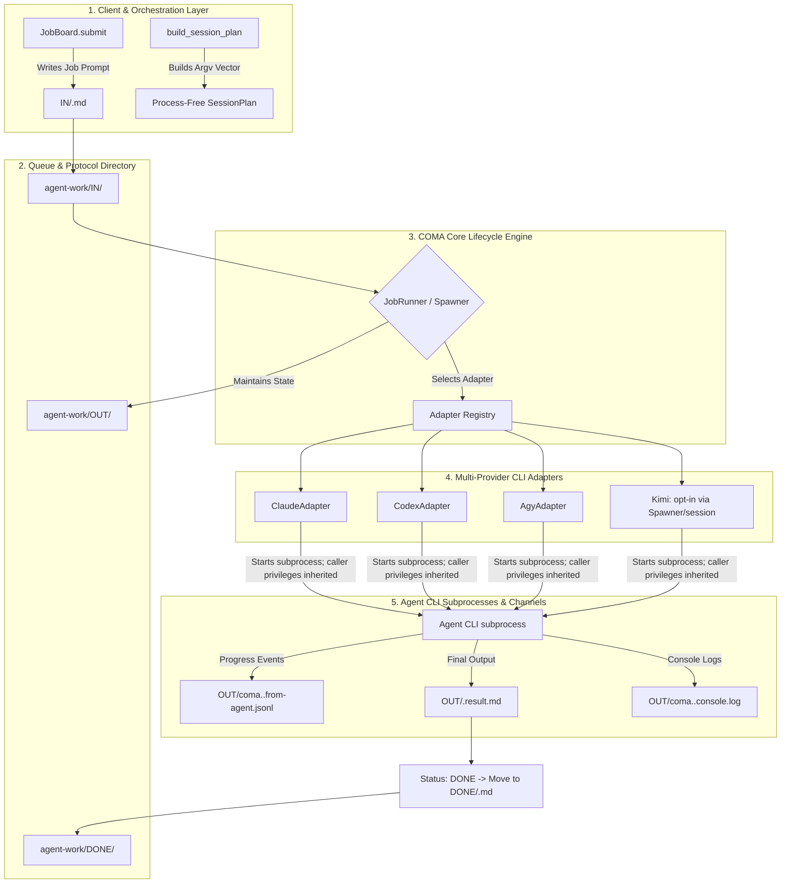
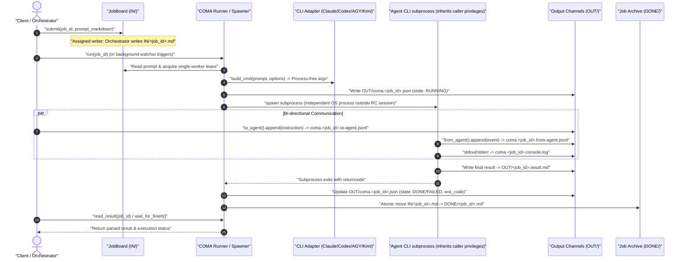

# COMA — Command & Communication for Autonomous Agents

**[English](README.md) | [Deutsch](README_de.md)**

[](https://github.com/ellmos-ai/coma/actions/workflows/tests.yml)
[](THIRD_PARTY_LICENSES.txt)
[](pyproject.toml)
[](https://www.python.org/)
[](pyproject.toml)
[](KONZEPT.md)
[](README.md#5-job-protocol)
[](SECURITY.md)
[](LICENSE)
[](llms.txt)
[](https://github.com/ellmos-ai)
[](https://github.com/open-bricks)

> [!NOTE]
> **LLM / AI Context Index:** For an AI-optimized specification, tool signatures, and architecture overview, see [`llms.txt`](llms.txt).

> **Name Migration Notice:** The project and canonical Python package are named `COMA` / `coma`. The legacy name `COMAS`/`comas` remains available during a transition period as an import and CLI alias; new integrations must use `coma`.

---

### Quick Navigation

1. [What Is COMA? & Value Proposition](#1-what-is-coma) · 2. [Primary Use Cases & Session Decoupling](#2-use-cases) · 3. [Target Personas & Discoverability](#3-target-personas--discoverability) · 4. [Quickstart & Command Line Usage](#4-quickstart) · 5. [File-Based Job Board Protocol](#5-job-protocol) · 6. [Spawner Layer & Multi-Engine CLI Adapters](#6-spawner-layer) · 7. [Interactive & Headless Session Planning](#7-interactive-and-headless-sessions) · 8. [Starters from roles[] Declarations](#8-starters-from-roles) · 9. [COMA Behavior and Boundaries](#9-coma-behavior-and-boundaries) · 10. [Dual Mermaid Diagrams](#10-dual-mermaid-diagrams) · 11. [Governance & Runtime Contracts](#11-governance-and-runtime-invariants) · 12. [CLI Commands Reference](#12-cli-commands) · 13. [Testing & Verification Suite](#13-testing) · 14. [Third-Party Licenses & Level 1 SBOM](#14-third-party-licenses--sbom) · 15. [Sibling Ecosystem & Integration](#15-sibling-tools--ecosystem) · 16. [Security Policy & Subprocess Isolation](#16-security) · 17. [Statutory Notice (§ 521 BGB)](#17-statutory-notice--liability-limitation) · 18. [License & Open-Source Umbrella](#18-license--umbrella)

---

<a id="sec-01"></a>
<a id="1-what-is-coma--value-proposition"></a>
<a id="1-what-is-coma"></a>
<a id="what-is-coma"></a>
<a id="1-was-ist-coma--kernnutzen"></a>
<a id="1-was-ist-coma"></a>
<a id="was-ist-coma"></a>
<a id="1-features"></a>
<a id="features"></a>
## 1. What Is COMA? & Value Proposition

> **The Agent Lifecycle Layer:** How is an autonomous AI agent spawned as a standalone process, and how do you communicate with it while it runs?

COMA is a **session-decoupled communication channel and process spawner for autonomous AI agents** (file-system based via `IN/`, `OUT/`, `DONE/`). The name stands for **Command & Communication for Autonomous Subagents**.

COMA coordinates work through local files and starts agent CLIs as subprocesses. COMA itself does not implement a network service or require a COMA account. A launched CLI may contact its provider or other services and may require its own account or network access. The project declares no direct Python runtime package dependencies.

See [`KONZEPT.md`](KONZEPT.md) for background details, motivations, and architectural decisions.

| Layer | Core Question | Handled By |
|---|---|---|
| **Lifecycle & Communication** | How to spawn an agent and stream input/output? | **COMA** |
| Access Control & Locks | Who can touch which resource/repo? | `lock-master` → Roshambo |
| Memory & History | Was this attempted before, what was the outcome? | `memoryhooker` / Roshambo |

Separation of verbs: COMA uses `spawn`, `send`, `poll`, `result`. A coordinator uses `claim`, `release`, `remember`, `recall`, `decide`, `status`. No overlap.

---

<a id="sec-02"></a>
<a id="2-primary-use-cases--session-decoupling"></a>
<a id="2-use-cases"></a>
<a id="use-cases"></a>
<a id="2-primaere-anwendungsfaelle--session-entkopplung"></a>
<a id="2-anwendungsfaelle"></a>
<a id="anwendungsfaelle"></a>
## 2. Primary Use Cases & Session Decoupling

1. **Decoupling from Remote Control (RC) Sessions**
   Interactive and remote-control clients can handle CLI permissions differently. COMA starts the selected CLI as a subprocess and exchanges work through filesystem channels; the provider CLI's own permissions remain in effect.

2. **Session-Independent Handoffs & Relays**
   Tasks can be handed off across session boundaries between agents without blocking process threads or losing context.

3. **Background Job Execution**
   File-system based queueing (`IN/`, `OUT/`, `DONE/`) for autonomous background runners and decoupled tool executions.

### ASCII Four-View Architectural Topology

COMA keeps four responsibilities explicit:

- Clients build commands and submit jobs.
- The job board coordinates through local files and caller-assigned channel writers.
- The spawner starts provider CLIs as subprocesses that inherit caller privileges.
- Documentation describes provider, network, permission, and cleanup boundaries.


---

<a id="sec-03"></a>
<a id="3-target-personas--discoverability"></a>
<a id="3-personas"></a>
<a id="target-personas--discoverability"></a>
<a id="personas"></a>
<a id="3-zielgruppen--auffindbarkeit"></a>
<a id="3-zielgruppen"></a>
<a id="zielgruppen--auffindbarkeit"></a>
## 3. Target Personas & Discoverability

COMA is for developers integrating agent CLIs, teams coordinating jobs through local files, and maintainers who need to review subprocess permissions and data flow. It does not provide an agent, provider account, or security sandbox; selected CLIs keep their own permission and network behavior.

---

<a id="sec-04"></a>
<a id="4-quickstart--command-line-usage"></a>
<a id="4-quickstart"></a>
<a id="quickstart"></a>
<a id="4-schnellstart--kommandozeilen-nutzung"></a>
<a id="4-schnellstart"></a>
<a id="schnellstart"></a>
## 4. Quickstart & Command Line Usage

Install COMA from the canonical Git repository with `python -m pip install "git+https://github.com/ellmos-ai/coma.git"`. The PyPI distribution named `coma` is a different project.

```python
from coma import JobBoard, JobRunner

board = JobBoard(r"C:\path\to\agent-work")
board.submit("myjob", "# Instructions\nWrite result to OUT/myjob.result.md.\n")

result = JobRunner(board).run("myjob")
print(result["status"]["state"], result["result_written"])
```

Or from the command line:

```bat
coma --root C:\path\to\agent-work run myjob
coma --root C:\path\to\agent-work run myjob --dry-run   :: preview command without launching
coma --root C:\path\to\agent-work status myjob
coma --root C:\path\to\agent-work result myjob
```

`--dry-run` constructs the complete command and displays it without consuming tokens or starting a process.

---

<a id="sec-05"></a>
<a id="5-file-based-job-board-protocol"></a>
<a id="5-job-protocol"></a>
<a id="job-protocol"></a>
<a id="5-dateibasiertes-job-board-protokoll"></a>
<a id="5-job-protokoll"></a>
<a id="das-protokoll"></a>
<a id="protokoll"></a>
## 5. File-Based Job Board Protocol

```
IN/    <jobid>.md                       Job prompt (Markdown)
OUT/   <jobid>.result.md                Final agent result output
       coma.<jobid>.json               Runner status (written by runner only)
       coma.<jobid>.from-agent.jsonl   Progress stream (written by agent only)
       coma.<jobid>.to-agent.jsonl     Instruction stream (written by orchestrator only)
       coma.<jobid>.console.log        Combined stdout / stderr log
DONE/  <jobid>.md                       Completed job prompt
```

**Channel writers:** Callers must assign one writer per channel file. Role checks do not provide OS locking or identity enforcement; callers coordinate concurrent writers.

---

<a id="sec-06"></a>
<a id="6-spawner-layer--multi-engine-cli-adapters"></a>
<a id="6-spawner-layer"></a>
<a id="spawner-layer"></a>
<a id="6-spawner-schicht--multi-engine-cli-adapter"></a>
<a id="6-spawn-schicht"></a>
<a id="die-spawn-schicht"></a>
## 6. Spawner Layer & Multi-Engine CLI Adapters

Adapters encapsulate CLI arguments for specific agent engines:

```python
from coma import ClaudeAdapter, Spawner

adapter = ClaudeAdapter(model="sonnet", permission_mode="dontAsk",
                        allowed_tools=["Read", "Write"], max_budget_usd=2.0)
print(adapter.build_cmd("Say Hello"))   # Returns argument list without running

spawner = Spawner(adapter)
result = spawner.run("Say Hello", log_file="run.log")
```

### Versioned Adapter Compatibility Notes

The version strings record prior local checks, not a current support guarantee or live-provider verification.

| Adapter | Target Engine | Historical note |
|---|---|---|
| claude | Anthropic Claude Code CLI | Prior flag check against version 2.1.263; not a current certification |
| codex | OpenAI Codex CLI | Prior compatibility check against version 0.153.4; not a current certification |
| agy | Google Antigravity / AGY CLI | Prior compatibility check against version 1.1.27; not a current certification |
| kimi | Kimi Code CLI | Skeleton; prior help contract check against version 0.31.0; no live prompt run |
---

<a id="sec-07"></a>
<a id="7-interactive-and-headless-session-planning"></a>
<a id="7-interactive-and-headless-sessions"></a>
<a id="interactive-and-headless-sessions"></a>
<a id="7-interaktive-und-headless-sitzungsplanung"></a>
<a id="7-interaktive-und-headless-sitzungen"></a>
<a id="interaktive-und-headless-sitzungen"></a>
## 7. Interactive and Headless Session Planning

`build_session_plan()` creates provider-specific argv without starting a process. A role prompt file and the user request remain separate arguments. `ordered_candidates()` and `available_candidates()` build a deterministic provider fallback chain.

Probe commands are not uniformly read-only: Codex uses `--sandbox read-only`; Claude receives `--strict-mcp-config` but no general read-only sandbox; AGY and Kimi add no access restriction. Inspect generated arguments and the selected CLI permissions before running. Probe cleanup is best-effort and platform-dependent. Kimi opt-in applies to adapter session planning and spawner execution; `build_probe_command()` has no separate fail-closed guard.

```python
from coma import build_session_plan

plan = build_session_plan(
    "codex", prompt_file="AGENTS.md", request="Review the current change.",
    mode="interactive", model="gpt-6", effort="high", cwd=".",
)
print(plan.command)  # argv only; no process has started
```

---

<a id="sec-08"></a>
<a id="8-starters-from-roles-declarations"></a>
<a id="8-starters-from-roles"></a>
<a id="starters-from-roles"></a>
<a id="8-starter-aus-roles-deklarationen"></a>
<a id="8-starter-aus-roles"></a>
<a id="starter-aus-roles"></a>
## 8. Starters from roles[] Declarations

`coma starters generate` reads a user-provided module manifest with a top-level `roles[]` array. Each role must include `id`, `prompt`, `request`, and a non-empty `providers` list. The prompt path is relative to the manifest and the file must exist. `ellmos-module.v2.json` describes COMA itself and is not a starter roles manifest.

```json
{
  "id": "my-module",
  "roles": [
    { "id": "reviewer", "prompt": "prompts/reviewer.md", "request": "Review the current change.", "providers": ["codex"] }
  ]
}
```

```bat
coma starters generate --manifest my-module.json --output-dir starters
starters\START.bat reviewer --provider codex --dry-run
```

---

<a id="sec-09"></a>
<a id="9-10-dimension-comparative-matrix-vs-alternatives"></a>
<a id="9-coma-behavior-and-boundaries"></a>
<a id="9-comparative-matrix-vs-alternatives"></a>
<a id="comparative-matrix-vs-alternatives"></a>
<a id="comparative-matrix"></a>
<a id="9-10-dimensionen-vergleichsmatrix-vs-alternativen"></a>
<a id="9-vergleichsmatrix-vs-alternativen"></a>
<a id="vergleichsmatrix-vs-alternativen"></a>
<a id="vergleichsmatrix"></a>
## 9. COMA Behavior and Boundaries

| Dimension | COMA behavior and limit |
|---|---|
| Job coordination | Local directory and file-based job protocol. |
| Direct Python runtime packages | None are declared in `pyproject.toml`; this says nothing about provider CLIs or their own dependencies. |
| Network behavior | COMA itself does not implement a network service. A launched CLI may contact providers or other services. |
| Channel concurrency | Callers must assign one writer per channel. Role checks are not OS locks or identity enforcement. |
| Process permissions | Agent CLIs inherit the launching process privileges; COMA does not sandbox them. |
| Probe cleanup | Timeout and platform-dependent best-effort cleanup; descendants may remain. |
| Security reporting | Maintainers publish acknowledgment and triage targets in SECURITY.md. |

---

<a id="sec-10"></a>
<a id="10-dual-mermaid-diagrams-topology--lifecycle"></a>
<a id="10-dual-mermaid-diagrams"></a>
<a id="architecture-flow"></a>
<a id="lifecycle-sequence"></a>
<a id="10-duale-mermaid-diagramme-topologie--lebenszyklus"></a>
<a id="10-duale-mermaid-diagramme"></a>
<a id="architektur-fluss"></a>
<a id="lebenszyklus-sequenz"></a>
## 10. Dual Mermaid Diagrams

### System Architecture Topology (5 Layers)



### End-to-End Decoupled Execution Lifecycle



---

<a id="sec-11"></a>
<a id="11-governance--10-runtime-invariants"></a>
<a id="11-governance-and-runtime-invariants"></a>
<a id="governance-and-runtime-invariants"></a>
<a id="11-governance--10-laufzeit-invarianten"></a>
<a id="11-governance--und-laufzeit-invarianten"></a>
<a id="governance--und-laufzeit-invarianten"></a>
<a id="invariants"></a>
## 11. Governance & Runtime Contracts

The following table separates implementation behavior from caller conventions and maintainer policy:

| ID | Invariant | Description |
|---|---|---|
| **INV-COMA-01** | **Channel writer convention** | Callers must assign one writer per channel file. Optional role checks are not OS locks or identity enforcement; callers coordinate concurrency. |
| **INV-COMA-02** | **Direct runtime dependencies** | `pyproject.toml` declares no direct external Python runtime packages. COMA itself does not implement a network service; launched agent CLIs may access networks and services. |
| **INV-COMA-03** | **Subprocess lifecycle** | Provider CLIs start as subprocesses. Their permission behavior, privileges, and network access come from the CLI and launching environment; COMA does not sandbox them. |
| **INV-COMA-04** | **Process-Free Dry Runs** | Command builders (`build_cmd`, `build_session_plan`, `--dry-run`) construct argument lists deterministically without starting processes or consuming LLM tokens. |
| **INV-COMA-05** | **Deterministic CLI Fallback** | Multi-provider fallback chains (`ordered_candidates`) resolve binaries deterministically without silent execution of unverified engines. |
| **INV-COMA-06** | **Kimi execution opt-in** | Spawner/session execution through `coma.spawn` and `coma.session` requires explicit opt-in; raw adapter or probe argument construction does not enforce the gate. |
| **INV-COMA-07** | **Probe timeout and cleanup** | Reachability probes use a timeout and attempt platform-dependent cleanup. Windows requests process-tree termination; Unix kills the direct process. Descendant termination is not guaranteed. |
| **INV-COMA-08** | **Idempotent Dual-Platform Starters** | Starter scripts (`START.bat`, `start.sh`) generated from `roles[]` carry unique marker guards preventing accidental overwrites of custom wrappers. |
| **INV-COMA-09** | **Inherited privileges** | Child processes inherit the launching process privileges. COMA does not request elevation, drop privileges, or provide a security isolation boundary. |
| **INV-COMA-10** | **Maintainer response policy** | [`SECURITY.md`](SECURITY.md) states targets of acknowledgment within 48 hours and triage within 5 business days. |

---

<a id="sec-12"></a>
<a id="12-cli-commands--options-reference"></a>
<a id="12-cli-commands"></a>
<a id="cli-commands"></a>
<a id="12-cli-befehle--options-referenz"></a>
<a id="12-kommandozeile"></a>
<a id="kommandozeile"></a>
## 12. CLI Commands Reference

| Command | Purpose |
|---|---|
| `run [jobid]` | Execute job from queue |
| `run ... --dry-run` | Build and show command string without executing |
| `cmd <prompt>` | Show command string for custom prompt |
| `session --provider … --prompt-file … --request …` | Plan or start an interactive/headless role session |
| `starters generate` · `starters run` | Generate dual-platform `roles[]` starters or use their COMA fallback |
| `submit <jobid>` | Submit job prompt into `IN/` |
| `status <jobid>` · `list` | Check status of job(s) |
| `result <jobid>` · `log <jobid>` | Read result output or console log |
| `send <jobid> <text>` · `inbox <jobid>` | Send message or read progress stream |
| `adapters` | Show adapter status & detected binaries |
| `check` · `vendor` | Verify or build vendor manifest |

---

<a id="sec-13"></a>
<a id="13-testing--verification-suite"></a>
<a id="13-testing"></a>
<a id="testing"></a>
<a id="13-tests--verifikationssuite"></a>
<a id="13-tests"></a>
<a id="tests"></a>
## 13. Testing & Verification Suite

```bash
python -m pytest -ra -v
```

Tests mock provider CLI execution; the suite does not perform live-provider verification. A probe test starts a controlled local Python process to check reachability.


---

<a id="sec-14"></a>
<a id="14-third-party-licenses--level-1-sbom"></a>
<a id="14-third-party-licenses--sbom"></a>
<a id="third-party-licenses"></a>
<a id="14-drittanbieter-lizenzen--level-1-sbom"></a>
<a id="14-drittanbieter-lizenzen"></a>
<a id="drittanbieter-lizenzen"></a>
## 14. Third-Party Licenses & Level 1 SBOM

The project license is MIT. [`THIRD_PARTY_LICENSES.md`](THIRD_PARTY_LICENSES.md) inventories the project and listed Python dependencies. It does not certify the licenses of separately installed agent CLIs, provider services, the Python runtime, or build tools. The project declares no direct Python runtime package dependencies in `pyproject.toml`.
---

<a id="sec-15"></a>
<a id="15-sibling-ecosystem--architectural-integration"></a>
<a id="15-sibling-tools--ecosystem"></a>
<a id="sibling-tools--ecosystem"></a>
<a id="15-geschwister-oekosystem--architektonische-integration"></a>
<a id="15-geschwisterwerkzeuge--ökosystem"></a>
<a id="geschwisterwerkzeuge--ökosystem"></a>
## 15. Sibling Ecosystem & Integration

COMA is part of the `ellmos-ai` orchestration architecture and the broader `open-bricks` open-source umbrella:

| Layer / Ecosystem | Repository | Purpose |
|---|---|---|
| **Agent Orchestration** | [`ellmos-ai/coma`](https://github.com/ellmos-ai/coma) | Process lifecycle spawner & session-decoupled job board |
| **Autonomous Stream** | [`ellmos-ai/rinnsal`](https://github.com/ellmos-ai/rinnsal) | SQLite-buffered autonomous stream engine & connector relay |
| **Condition Verification** | [`ellmos-ai/condition-gates`](https://github.com/ellmos-ai/condition-gates) | Precondition checking, evidence validation & runtime invariants |
| **Lock Governance** | [`ellmos-ai/lock-master`](https://github.com/ellmos-ai/lock-master) | Central project locks & Multi-Tree coordination (Roshambo) |
| **Hook Management** | [`ellmos-ai/hook-master`](https://github.com/ellmos-ai/hook-master) | Canonical hook management & multi-agent materialization |
| **Policy Registry** | [`ellmos-ai/policy-registry`](https://github.com/ellmos-ai/policy-registry) | Central governance, role definitions & delegation rules |
| **Fleet Operations** | [`ellmos-ai/agent-ops-stack`](https://github.com/ellmos-ai/agent-ops-stack) | Multi-agent operations, health telemetry & monitoring |
| **Data Transit** | [`ellmos-ai/sqlite-transit-sync`](https://github.com/ellmos-ai/sqlite-transit-sync) | Zero-copy transaction sync & SQLite replication |
| **Automation Flow** | [`ellmos-ai/workflowhooker`](https://github.com/ellmos-ai/workflowhooker) | Event triggers, pipeline hooks & webhook orchestration |
| **Memory Retention** | [`ellmos-ai/memoryhooker`](https://github.com/ellmos-ai/memoryhooker) | Context retention, episodic memory & lesson synthesis |
| **Agent Bootstrap** | [`dev-bricks/safe-start-for-codex`](https://github.com/dev-bricks/safe-start-for-codex) | Safe startup, environment checks & preflight diagnostics |
| **Umbrella Ecosystem** | [`open-bricks`](https://github.com/open-bricks) | Open-source foundation for local-first developer tools |

Documented integrations in public repositories are optional or use COMA at a specific integration point; they do not imply a hard dependency:

- [swarm_ai](https://github.com/ellmos-ai/swarm_ai) uses COMA Spawner and adapter APIs for provider-backed workflows.
- [marblerun](https://github.com/ellmos-ai/marblerun) integrates with COMA Spawner and adapters.
- [ellmos-scheduler](https://github.com/ellmos-ai/ellmos-scheduler) integrates with COMA Spawner and adapters.
- [task-master](https://github.com/ellmos-ai/task-master) has an optional COMA integration.
- [open-ocean](https://github.com/ellmos-ai/open-ocean) checks for optional COMA session support and provides a CLI fallback.
- [ticket-master](https://github.com/ellmos-ai/ticket-master) uses COMA Starters at build time; it is not a runtime integration.

---

<a id="sec-16"></a>
<a id="16-security-architecture--subprocess-isolation"></a>
<a id="16-security"></a>
<a id="security"></a>
<a id="16-sicherheitsarchitektur--subprozess-isolation"></a>
<a id="16-sicherheit"></a>
<a id="sicherheit"></a>
## 16. Security Boundaries and Reporting

COMA starts provider CLIs as subprocesses. Child processes inherit the launching process privileges and may use the network; COMA does not sandbox them. For channel conventions, probe cleanup limits, and vulnerability reporting, see [`SECURITY.md`](SECURITY.md).
---

<a id="sec-17"></a>
<a id="17-statutory-notice--liability-limitation-521-bgb"></a>
<a id="17-statutory-notice--liability-limitation"></a>
<a id="statutory-notice"></a>
<a id="17-gesetzlicher-hinweis--haftungsbeschraenkung-521-bgb"></a>
<a id="17-gesetzlicher-hinweis--haftungsbeschraenkung"></a>
<a id="gesetzlicher-hinweis"></a>
## 17. Statutory Notice (§ 521 BGB)

The project is provided under the MIT license. Whether statutory rules such as section 521 BGB apply depends on the legal relationship and applicable law; this documentation does not provide a blanket exemption from liability.
---

<a id="sec-18"></a>
<a id="18-license--open-source-umbrella"></a>
<a id="18-license--umbrella"></a>
<a id="license"></a>
<a id="18-lizenz--open-source-dach"></a>
<a id="18-stand--lizenz"></a>
<a id="stand--lizenz"></a>
## 18. License & Open-Source Umbrella

MIT License. Developed under the [ellmos-ai](https://github.com/ellmos-ai) / [open-bricks](https://github.com/open-bricks) ecosystem. See [LICENSE](LICENSE) and [NOTICE](NOTICE) for copyright attribution.
