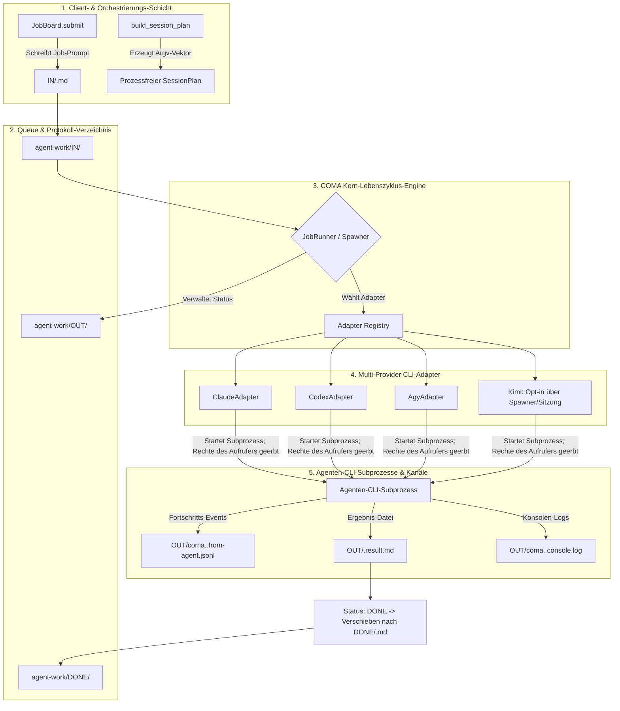
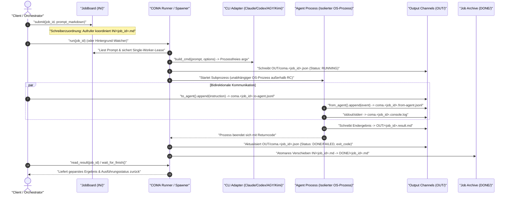

# COMA — Command & Communication for Autonomous Agents

**[English](README.md) | [Deutsch](README_de.md)**

[](https://github.com/ellmos-ai/coma/actions/workflows/tests.yml)
[](THIRD_PARTY_LICENSES.txt)
[](pyproject.toml)
[](https://www.python.org/)
[](pyproject.toml)
[](KONZEPT.md)
[](README_de.md#5-job-protokoll)
[](SECURITY.md)
[](LICENSE)
[](llms.txt)
[](https://github.com/ellmos-ai)
[](https://github.com/open-bricks)

> [!NOTE]
> **LLM/KI-Kontext-Index:** Eine maschinenlesbare Spezifikation und Architektur-Übersicht für KI-Agenten befindet sich in [`llms.txt`](llms.txt).

> **Namensmigration:** Das Projekt und das kanonische Python-Paket heißen `COMA` bzw. `coma`. Der frühere Name `COMAS`/`comas` bleibt für eine Übergangsphase als Import- und CLI-Alias verfügbar; neue Integrationen müssen `coma` verwenden.

---

### Schnellnavigation

1. [Was ist COMA? & Kernnutzen](#1-was-ist-coma) · 2. [Primäre Anwendungsfälle & Session-Entkopplung](#2-anwendungsfaelle) · 3. [Zielgruppen & Auffindbarkeit](#3-zielgruppen--auffindbarkeit) · 4. [Schnellstart & CLI-Nutzung](#4-schnellstart) · 5. [Dateibasiertes Job-Board-Protokoll](#5-job-protokoll) · 6. [Spawner-Schicht & Multi-Engine CLI-Adapter](#6-spawner-schicht) · 7. [Interaktive & Headless Sitzungsplanung](#7-interaktive-und-headless-sitzungen) · 8. [Starter aus roles[] Deklarationen](#8-starter-aus-roles) · 9. [COMA-Verhalten und Grenzen](#9-coma-verhalten-und-grenzen) · 10. [Duale Mermaid-Diagramme](#10-duale-mermaid-diagramme) · 11. [Governance & Laufzeitverträge](#11-governance--und-laufzeit-invarianten) · 12. [CLI-Befehlsreferenz](#12-kommandozeile) · 13. [Tests & Verifikationssuite](#13-tests) · 14. [Drittanbieter-Lizenzen & Level 1 SBOM](#14-drittanbieter-lizenzen) · 15. [Geschwister-Ökosystem & Integration](#15-geschwisterwerkzeuge--ökosystem) · 16. [Sicherheitsarchitektur & Subprozess-Isolation](#16-sicherheit) · 17. [Gesetzlicher Hinweis (§ 521 BGB)](#17-gesetzlicher-hinweis--haftungsbeschraenkung) · 18. [Lizenz & Open-Source-Dach](#18-stand--lizenz)

---

<a id="sec-01"></a>
<a id="1-was-ist-coma--kernnutzen"></a>
<a id="1-was-ist-coma"></a>
<a id="was-ist-coma"></a>
<a id="1-what-is-coma--value-proposition"></a>
<a id="1-what-is-coma"></a>
<a id="what-is-coma"></a>
<a id="1-funktionen"></a>
<a id="kernfunktionen"></a>
## 1. Was ist COMA? & Kernnutzen

> Die **Lebenszyklus-Schicht** für Agenten: Wie entsteht ein Agent als eigener Prozess, und wie bleibt man mit ihm in Kontakt, solange er läuft?

COMA steht primär als **session-übergreifender und session-unabhängiger Kommunikations- und Auftragskanal für autonome Subagents** (Dateisystem-basiert via `IN/`, `OUT/`, `DONE/`). Als Begriffsauslegung steht **Command & Communication for Autonomous Subagents** im Mittelpunkt.

COMA koordiniert Aufträge über lokale Dateien und startet Anbieter-CLIs als Subprozesse. COMA selbst stellt keinen Netzwerkdienst bereit und benötigt kein eigenes Konto. Gestartete CLIs können ihre Anbieter oder andere Dienste kontaktieren und eigene Konten oder Netzzugriff benötigen. Das Projekt deklariert keine direkten externen Python-Laufzeitpakete.

Konzept, Begründung und Abgrenzung: [`KONZEPT.md`](KONZEPT.md).

| Schicht | Frage | Zuständig |
|---|---|---|
| **Lebenszyklus & Kommunikation** | Wie entsteht ein Agent, wie rede ich mit ihm? | **COMA** |
| Anspruch & Locks | Wer darf was anfassen? | `lock-master` → Roshambo |
| Gedächtnis & Verlauf | Wurde das schon versucht, wie ging es aus? | `memoryhooker` / Roshambo |

Die Verben trennen sauber: COMA spricht `spawn`, `send`, `poll`, `result`. Ein Koordinator spricht `claim`, `release`, `remember`, `recall`, `decide`, `status`. Keine Überschneidung.

---

<a id="sec-02"></a>
<a id="2-primaere-anwendungsfaelle--session-entkopplung"></a>
<a id="2-anwendungsfaelle"></a>
<a id="anwendungsfaelle"></a>
<a id="2-primary-use-cases--session-decoupling"></a>
<a id="2-use-cases"></a>
<a id="use-cases"></a>
## 2. Primäre Anwendungsfälle & Session-Entkopplung

1. **Entkopplung von Remote-Control-Sessions (RC-Immunität)**
   Interaktive Clients und Remote-Control-Sitzungen können CLI-Berechtigungen unterschiedlich handhaben. COMA startet das gewählte CLI als Subprozess und tauscht Aufträge über Dateisystemkanäle aus; die Berechtigungen des Anbieter-CLIs gelten weiterhin.

   Die Lösung ist, den Agenten **gar nicht erst in der RC-Session leben zu lassen**: Ein eigener lokaler Betriebssystem-Prozess außerhalb dieser Session, Kommunikation robust über das Dateisystem. **COMA umgeht keine Sicherheitsgrenze**, sondern nutzt dokumentierte CLI-Flags (`--permission-mode`, `--allowedTools`) an der Stelle, an der sie tatsächlich ankommen.

2. **Session-übergreifende Handoffs & Multi-Agent Relays**
   Aufgaben werden über Session-Grenzen hinweg zwischen Agenten übergeben, ohne dass Prozesse blockieren oder Kontext verloren geht.

3. **Hintergrund-Auftragsverarbeitung**
   Dateisystem-basierte Steuerung (`IN/`, `OUT/`, `DONE/`) für autonome Hintergrund-Läufer und entkoppelte Tool-Ausführungen.

### ASCII Vier-Sichten-Architekturtopologie

COMA trennt vier Aufgaben:

- Clients planen Befehle und übergeben Aufträge.
- Das Job-Board koordiniert Dateien und von Aufrufern zugeordnete Kanalschreiber.
- Der Spawner startet Anbieter-CLIs mit den geerbten Rechten des Aufrufers.
- Die Dokumentation benennt Netzwerk-, Rechte- und Bereinigungsgrenzen.


---

<a id="sec-03"></a>
<a id="3-zielgruppen--auffindbarkeit"></a>
<a id="3-zielgruppen"></a>
<a id="zielgruppen--auffindbarkeit"></a>
<a id="3-target-personas--discoverability"></a>
<a id="3-personas"></a>
<a id="target-personas--discoverability"></a>
<a id="personas"></a>
## 3. Zielgruppen & Auffindbarkeit

COMA richtet sich an Entwickler, die Anbieter-CLIs integrieren, Teams mit dateibasierter Auftragskoordination und Maintainer, die Rechte und Datenflüsse gestarteter Subprozesse prüfen müssen. COMA liefert weder einen Agenten noch ein Anbieter-Konto oder eine Sicherheits-Sandbox; Rechte und Netzwerkverhalten hängen von der jeweiligen CLI ab.

---

<a id="sec-04"></a>
<a id="4-schnellstart--kommandozeilen-nutzung"></a>
<a id="4-schnellstart"></a>
<a id="schnellstart"></a>
<a id="4-quickstart--command-line-usage"></a>
<a id="4-quickstart"></a>
<a id="quickstart"></a>
## 4. Schnellstart & CLI-Nutzung

Installation aus dem kanonischen Git-Repository: `python -m pip install "git+https://github.com/ellmos-ai/coma.git"`. Das PyPI-Paket namens `coma` ist ein anderes Projekt.

```python
from coma import JobBoard, JobRunner

board = JobBoard(r"C:\path\to\agent-work")
board.submit("meinjob", "# Auftrag\n\nSchreibe das Ergebnis nach OUT/meinjob.result.md.\n")

result = JobRunner(board).run("meinjob")
print(result["status"]["state"], result["result_written"])
```

Oder von der Kommandozeile:

```bat
coma --root C:\path\to\agent-work run meinjob
coma --root C:\path\to\agent-work run meinjob --dry-run   :: nur zeigen, nichts starten
coma --root C:\path\to\agent-work status meinjob
coma --root C:\path\to\agent-work result meinjob
```

`--dry-run` baut das vollständige Kommando und zeigt es, ohne dass ein Token fließt oder ein Prozess gestartet wird.

---

<a id="sec-05"></a>
<a id="5-dateibasiertes-job-board-protokoll"></a>
<a id="5-job-protokoll"></a>
<a id="das-protokoll"></a>
<a id="protokoll"></a>
<a id="5-file-based-job-board-protocol"></a>
<a id="5-job-protocol"></a>
<a id="job-protocol"></a>
## 5. Dateibasiertes Job-Board-Protokoll

```
IN/    <jobid>.md                       Auftrag (Freitext-Markdown)
OUT/   <jobid>.result.md                Ergebnis
       coma.<jobid>.json               Status      — nur der Runner schreibt
       coma.<jobid>.from-agent.jsonl   Fortschritt — nur der Agent schreibt
       coma.<jobid>.to-agent.jsonl     Nachrichten — nur der Orchestrator schreibt
       coma.<jobid>.console.log        Konsolen-Log (stdout/stderr kombiniert)
DONE/  <jobid>.md                       Erledigter Auftrag (wird bei Erfolg verschoben)
```

**Kanalschreiber:** Aufrufer müssen jedem Kanal genau einen Schreiber zuordnen. Rollenprüfungen sind weder Betriebssystem-Sperren noch Identitätsprüfung; Aufrufer koordinieren parallele Schreiber.

---

<a id="sec-06"></a>
<a id="6-spawner-schicht--multi-engine-cli-adapter"></a>
<a id="6-spawn-schicht"></a>
<a id="die-spawn-schicht"></a>
<a id="spawner-schicht"></a>
<a id="6-spawner-layer--multi-engine-cli-adapters"></a>
<a id="6-spawner-layer"></a>
<a id="spawner-layer"></a>
## 6. Spawner-Schicht & Multi-Engine CLI-Adapter

Adapter kapseln CLI-Argumente für spezifische Agenten-Engines:

```python
from coma import ClaudeAdapter, Spawner

adapter = ClaudeAdapter(model="sonnet", permission_mode="dontAsk",
                        allowed_tools=["Read", "Write"], max_budget_usd=2.0)
print(adapter.build_cmd("Sag Hallo"))   # Zeigt Argumentliste ohne Ausführung

spawner = Spawner(adapter)
result = spawner.run("Sag Hallo", log_file="run.log")
```

### Historische CLI-Kompatibilitätsprüfungen

Die Versionsangaben dokumentieren frühere lokale Prüfungen, keine aktuelle Supportzusage oder Live-Anbieter-Verifikation.

| Adapter | Ziel-Engine | Historischer Prüfstand |
|---|---|---|
| claude | Anthropic Claude Code CLI | Frühere Flag-Prüfung gegen Version 2.1.263; keine aktuelle Zertifizierung |
| codex | OpenAI Codex CLI | Frühere Kompatibilitätsprüfung gegen Version 0.153.4 |
| agy | Google Antigravity / AGY CLI | Frühere Kompatibilitätsprüfung gegen Version 1.1.27 |
| kimi | Kimi Code CLI | Gerüst; frühere Hilfe-Vertragsprüfung gegen Version 0.31.0; kein Live-Promptlauf |
---

<a id="sec-07"></a>
<a id="7-interaktive-und-headless-sitzungsplanung"></a>
<a id="7-interaktive-und-headless-sitzungen"></a>
<a id="interaktive-und-headless-sitzungen"></a>
<a id="7-interactive-and-headless-session-planning"></a>
<a id="7-interactive-and-headless-sessions"></a>
<a id="interactive-and-headless-sessions"></a>
## 7. Interaktive & Headless Sitzungsplanung

`build_session_plan()` erstellt anbieterabhängige Argumentlisten, ohne einen Prozess zu starten. Rollen-Prompt-Datei und Nutzeranfrage bleiben getrennte Argumente. `ordered_candidates()` und `available_candidates()` bauen eine deterministische Provider-Fallback-Kette.

Nicht alle Sonden sind lesebeschränkt: Codex erhält `--sandbox read-only`; Claude erhält `--strict-mcp-config`, jedoch keine allgemeine Nur-Lese-Sandbox; AGY und Kimi ergänzen keine Zugriffsbeschränkung. Prüfe Argumente und Rechte des gewählten CLI vor dem Start. Die Sondenbereinigung erfolgt nach bestem Bemühen und ist plattformabhängig. Kimi-Opt-in gilt für Adapter-Sitzungsplanung und Spawner-Ausführung; `build_probe_command()` enthält keine eigene Fail-Closed-Sperre.

```python
from coma import build_session_plan

plan = build_session_plan(
    "codex", prompt_file="AGENTS.md", request="Review den aktuellen Stand.",
    mode="interactive", model="gpt-6", effort="high", cwd=".",
)
print(plan.command)  # Nur argv; kein Prozess gestartet
```

---

<a id="sec-08"></a>
<a id="8-starter-aus-roles-deklarationen"></a>
<a id="8-starter-aus-roles"></a>
<a id="starter-aus-roles"></a>
<a id="8-starters-from-roles-declarations"></a>
<a id="8-starters-from-roles"></a>
<a id="starters-from-roles"></a>
## 8. Starter aus roles[] Deklarationen

`coma starters generate` liest ein vom Nutzer bereitgestelltes Modul-Manifest mit einer obersten `roles[]`-Liste. Jede Rolle benötigt `id`, `prompt`, `request` und eine nichtleere `providers`-Liste. Der Promptpfad gilt relativ zum Manifest und die Datei muss existieren. `ellmos-module.v2.json` beschreibt COMA selbst und ist kein Rollenmanifest für Starter.

```json
{
  "id": "my-module",
  "roles": [
    { "id": "reviewer", "prompt": "prompts/reviewer.md", "request": "Review the current change.", "providers": ["codex"] }
  ]
}
```

```bat
coma starters generate --manifest my-module.json --output-dir starters
starters\START.bat reviewer --provider codex --dry-run
```

---

<a id="sec-09"></a>
<a id="9-10-dimensionen-vergleichsmatrix-vs-alternativen"></a>
<a id="9-coma-verhalten-und-grenzen"></a>
<a id="9-vergleichsmatrix-vs-alternativen"></a>
<a id="vergleichsmatrix-vs-alternativen"></a>
<a id="vergleichsmatrix"></a>
<a id="9-10-dimension-comparative-matrix-vs-alternatives"></a>
<a id="9-comparative-matrix-vs-alternatives"></a>
<a id="comparative-matrix-vs-alternatives"></a>
<a id="comparative-matrix"></a>
## 9. COMA-Verhalten und Grenzen

| Dimension | COMA-Verhalten und Grenze |
|---|---|
| Auftragskoordination | Lokales Verzeichnis und dateibasiertes Job-Protokoll. |
| Direkte Python-Laufzeitpakete | In pyproject.toml sind keine deklariert; dies sagt nichts über Anbieter-CLIs oder deren Abhängigkeiten aus. |
| Netzwerkverhalten | COMA selbst stellt keinen Netzwerkdienst bereit. Gestartete CLIs können Anbieter oder andere Dienste kontaktieren. |
| Kanalparallelität | Aufrufer ordnen jedem Kanal einen Schreiber zu. Rollenprüfungen sind keine Betriebssystem-Sperren oder Identitätsprüfung. |
| Prozessrechte | Anbieter-CLIs erben Rechte des startenden Prozesses; COMA isoliert sie nicht in einer Sandbox. |
| Sondenbereinigung | Timeout und plattformabhängiger Bereinigungsversuch; Kindprozesse können bestehen bleiben. |
| Sicherheitsmeldungen | Maintainer dokumentieren Bestätigungs- und Triage-Ziele in SECURITY.md. |


---

<a id="sec-10"></a>
<a id="10-duale-mermaid-diagramme-topologie--lebenszyklus"></a>
<a id="10-duale-mermaid-diagramme"></a>
<a id="architektur-fluss"></a>
<a id="lebenszyklus-sequenz"></a>
<a id="10-dual-mermaid-diagrams-topology--lifecycle"></a>
<a id="10-dual-mermaid-diagrams"></a>
<a id="architecture-flow"></a>
<a id="lifecycle-sequence"></a>
## 10. Duale Mermaid-Diagramme

### System-Architektur-Topologie (5 Schichten)



### Durchgängiger Lebenszyklus (End-to-End Entkopplung)



---

<a id="sec-11"></a>
<a id="11-governance--10-laufzeit-invarianten"></a>
<a id="11-governance--und-laufzeit-invarianten"></a>
<a id="governance--und-laufzeit-invarianten"></a>
<a id="11-governance--10-runtime-invariants"></a>
<a id="11-governance-and-runtime-invariants"></a>
<a id="invariants"></a>
## 11. Governance & Laufzeitverträge

Die folgende Tabelle trennt Implementierungsverhalten, Aufruferkonventionen und Maintainer-Politik:

| ID | Invariante | Beschreibung |
|---|---|---|
| **INV-COMA-01** | **Kanalschreiber-Konvention** | Aufrufer müssen jedem Kanal einen Schreiber zuordnen. Rollenprüfungen sind weder OS-Sperren noch Identitätsprüfung; Aufrufer koordinieren Parallelität. |
| **INV-COMA-02** | **Direkte Laufzeitpakete** | pyproject.toml deklariert keine direkten externen Python-Laufzeitpakete. COMA selbst stellt keinen Netzwerkdienst bereit; gestartete CLIs können Netzwerke und Dienste nutzen. |
| **INV-COMA-03** | **Subprozess-Lebenszyklus** | Anbieter-CLIs starten als Subprozesse. Rechte, Netzwerkzugriff und Berechtigungsverhalten folgen der CLI und Startumgebung; COMA bietet keine Sandbox. |
| **INV-COMA-04** | **Prozessfreie Dry-Runs** | Befehlsbauer (`build_cmd`, `build_session_plan`, `--dry-run`) konstruieren Argumentlisten deterministisch, ohne Prozesse zu starten oder Tokens zu verbrauchen. |
| **INV-COMA-05** | **Deterministischer CLI-Fallback** | Multi-Provider-Fallback-Ketten (`ordered_candidates`) lösen Binaries systematisch auf, ohne unbestätigte Engines stillschweigend auszuführen. |
| **INV-COMA-06** | **Kimi-Ausführung mit Opt-in** | Die Ausführung über `coma.spawn` und `coma.session` erfordert ein ausdrückliches Opt-in; rohe Adapter- oder Probe-Argumentgeneratoren setzen diese Sperre nicht durch. |
| **INV-COMA-07** | **Sondentimeout und Bereinigung** | Sonden verwenden ein Timeout und versuchen eine plattformabhängige Bereinigung. Windows fordert Prozessbaumterminierung an; Unix beendet den direkten Prozess. Nachkommen werden nicht garantiert beendet. |
| **INV-COMA-08** | **Idempotente Dual-Platform-Starter** | Aus `roles[]` generierte Starter-Skripte (`START.bat`, `start.sh`) tragen Schutzmarker, die versehentliches Überschreiben eigener Skripte verhindern. |
| **INV-COMA-09** | **Geerbte Rechte** | Kindprozesse erben die Rechte des startenden Prozesses. COMA fordert keine Erhöhung an, gibt keine Rechte ab und bildet keine Sicherheitsgrenze. |
| **INV-COMA-10** | **Maintainer-Antwortpolitik** | SECURITY.md nennt Ziele für Bestätigung innerhalb von 48 Stunden und Triage innerhalb von 5 Werktagen. |

---

<a id="sec-12"></a>
<a id="12-cli-befehle--options-referenz"></a>
<a id="12-kommandozeile"></a>
<a id="kommandozeile"></a>
<a id="12-cli-commands--options-reference"></a>
<a id="12-cli-commands"></a>
## 12. CLI-Befehlsreferenz

| Befehl | Zweck |
|---|---|
| `run [jobid]` | Führt anstehenden Job aus der Warteschlange aus |
| `run ... --dry-run` | Zeigt vollständiges Kommando ohne Ausführung |
| `cmd <prompt>` | Zeigt Kommandozeilenaufruf für Freitext-Prompt |
| `session --provider … --prompt-file … --request …` | Plant oder startet interaktive/headless Rollen-Sitzung |
| `starters generate` · `starters run` | Generiert plattformübergreifende `roles[]`-Starter oder nutzt Fallback |
| `submit <jobid>` | Reicht Job-Prompt in `IN/` ein |
| `status <jobid>` · `list` | Prüft Status eines oder aller Jobs |
| `result <jobid>` · `log <jobid>` | Liest Ergebnisdatei oder Konsolen-Log |
| `send <jobid> <text>` · `inbox <jobid>` | Sendet Nachricht an laufenden Agenten oder liest Fortschritt |
| `adapters` | Zeigt Status und gefundene Pfade aller Adapter an |
| `check` · `vendor` | Prüft oder generiert Vendor-Manifest |

---

<a id="sec-13"></a>
<a id="13-tests--verifikationssuite"></a>
<a id="13-tests"></a>
<a id="tests"></a>
<a id="13-testing--verification-suite"></a>
<a id="13-testing"></a>
## 13. Tests & Verifikationssuite

```bat
python -m pytest -ra -v
```

Tests mocken die Ausführung von Anbieter-CLIs; die Suite ist keine Live-Anbieter-Verifikation.
Ein Sondentest startet einen kontrollierten lokalen Python-Prozess, um Erreichbarkeit zu prüfen.

---

<a id="sec-14"></a>
<a id="14-drittanbieter-lizenzen--level-1-sbom"></a>
<a id="14-drittanbieter-lizenzen"></a>
<a id="drittanbieter-lizenzen"></a>
<a id="14-third-party-licenses--level-1-sbom"></a>
<a id="14-third-party-licenses--sbom"></a>
## 14. Drittanbieter-Lizenzen & Level 1 SBOM

Das Projekt steht unter der MIT-Lizenz. [`THIRD_PARTY_LICENSES.md`](THIRD_PARTY_LICENSES.md) inventarisiert das Projekt und die dort aufgeführten Python-Pakete. Es zertifiziert nicht die Lizenzen separat installierter Agenten-CLIs, Anbieter-Dienste, der Python-Laufzeit oder von Build-Werkzeugen. pyproject.toml deklariert keine direkten externen Python-Laufzeitpakete.
---

<a id="sec-15"></a>
<a id="15-geschwister-oekosystem--architektonische-integration"></a>
<a id="15-geschwisterwerkzeuge--ökosystem"></a>
<a id="geschwisterwerkzeuge--ökosystem"></a>
<a id="15-sibling-ecosystem--architectural-integration"></a>
<a id="15-sibling-tools--ecosystem"></a>
## 15. Geschwister-Ökosystem & Integration

COMA ist integraler Bestandteil der `ellmos-ai`-Architektur und des `open-bricks`-Dachverbunds:

| Schicht / Ökosystem | Repository | Zweck |
|---|---|---|
| **Agenten-Orchestrierung** | [`ellmos-ai/coma`](https://github.com/ellmos-ai/coma) | Prozess-Lebenszyklus-Spawner & entkoppeltes Job-Board |
| **Autonome Datenströme** | [`ellmos-ai/rinnsal`](https://github.com/ellmos-ai/rinnsal) | SQLite-gepufferte autonome Stream-Engine & Relay |
| **Bedingungsprüfung** | [`ellmos-ai/condition-gates`](https://github.com/ellmos-ai/condition-gates) | Vorbedingungen, Evidenzvalidierung & Laufzeit-Invarianten |
| **Lock-Governance** | [`ellmos-ai/lock-master`](https://github.com/ellmos-ai/lock-master) | Zentrale Projektsperren & Multi-Tree-Koordination (Roshambo) |
| **Hook-Management** | [`ellmos-ai/hook-master`](https://github.com/ellmos-ai/hook-master) | Kanonisches Hook-Management & Multi-Agent-Materialisierung |
| **Richtlinien-Register** | [`ellmos-ai/policy-registry`](https://github.com/ellmos-ai/policy-registry) | Zentrale Governance, Rollendefinitionen & Delegationsregeln |
| **Flotten-Betrieb** | [`ellmos-ai/agent-ops-stack`](https://github.com/ellmos-ai/agent-ops-stack) | Multi-Agenten-Betrieb, Health-Telemetrie & Monitoring |
| **Datentransfer** | [`ellmos-ai/sqlite-transit-sync`](https://github.com/ellmos-ai/sqlite-transit-sync) | Zero-Copy Transaktions-Sync & SQLite-Replikation |
| **Automationsfluss** | [`ellmos-ai/workflowhooker`](https://github.com/ellmos-ai/workflowhooker) | Ereignistrigger, Pipeline-Hooks & Webhook-Orchestrierung |
| **Gedächtnissicherung** | [`ellmos-ai/memoryhooker`](https://github.com/ellmos-ai/memoryhooker) | Kontexterhalt, episodisches Gedächtnis & Lessons-Learned |
| **Agenten-Bootstrap** | [`dev-bricks/safe-start-for-codex`](https://github.com/dev-bricks/safe-start-for-codex) | Sicherer Start, Umgebungsprüfungen & Preflight-Diagnostik |
| **Dach-Ökosystem** | [`open-bricks`](https://github.com/open-bricks) | Open-Source-Fundament für lokale Entwicklerwerkzeuge |

Dokumentierte Integrationen in öffentlichen Repositories sind optional oder auf eine bestimmte Integrationsstelle begrenzt; sie begründen keine harte Abhängigkeit:

- [swarm_ai](https://github.com/ellmos-ai/swarm_ai) nutzt COMA Spawner- und Adapter-APIs für anbieterbasierte Workflows.
- [marblerun](https://github.com/ellmos-ai/marblerun) integriert COMA Spawner und Adapter.
- [ellmos-scheduler](https://github.com/ellmos-ai/ellmos-scheduler) integriert COMA Spawner und Adapter.
- [task-master](https://github.com/ellmos-ai/task-master) besitzt eine optionale COMA-Integration.
- [open-ocean](https://github.com/ellmos-ai/open-ocean) prüft optionale COMA-Sitzungsunterstützung und bietet einen CLI-Fallback.
- [ticket-master](https://github.com/ellmos-ai/ticket-master) verwendet COMA Starters zur Build-Zeit; es ist keine Laufzeitintegration.

---

<a id="sec-16"></a>
<a id="16-sicherheitsarchitektur--subprozess-isolation"></a>
<a id="16-sicherheit"></a>
<a id="sicherheit"></a>
<a id="16-security-architecture--subprocess-isolation"></a>
<a id="16-security"></a>
## 16. Sicherheitsgrenzen und Meldungen

COMA startet Anbieter-CLIs als Subprozesse. Kindprozesse erben Rechte des startenden Prozesses und können das Netzwerk nutzen; COMA bietet keine Sandbox. Kanalschreiber-Konvention, Sondenbereinigung und Meldungswege stehen in [`SECURITY.md`](SECURITY.md).
---

<a id="sec-17"></a>
<a id="17-gesetzlicher-hinweis--haftungsbeschraenkung-521-bgb"></a>
<a id="17-gesetzlicher-hinweis--haftungsbeschraenkung"></a>
<a id="gesetzlicher-hinweis"></a>
<a id="17-statutory-notice--liability-limitation-521-bgb"></a>
<a id="17-statutory-notice--liability-limitation"></a>
## 17. Gesetzlicher Hinweis (§ 521 BGB)

Das Projekt wird unter der MIT-Lizenz bereitgestellt. Ob gesetzliche Vorschriften wie § 521 BGB gelten, hängt vom Rechtsverhältnis und anwendbaren Recht ab; diese Dokumentation begründet keine pauschale Haftungsfreistellung.
---

<a id="sec-18"></a>
<a id="18-lizenz--open-source-dach"></a>
<a id="18-stand--lizenz"></a>
<a id="stand--lizenz"></a>
<a id="18-license--open-source-umbrella"></a>
<a id="18-license--umbrella"></a>
## 18. Lizenz & Open-Source-Dach

MIT-Lizenz. Entwickelt unter dem Dach von [ellmos-ai](https://github.com/ellmos-ai) und [open-bricks](https://github.com/open-bricks). Siehe [LICENSE](LICENSE) und [NOTICE](NOTICE) für Copyright- und Urheberhinweise.
